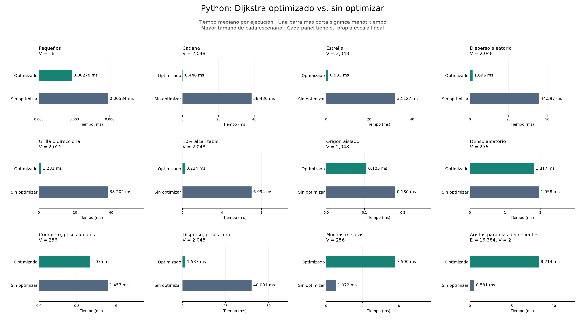
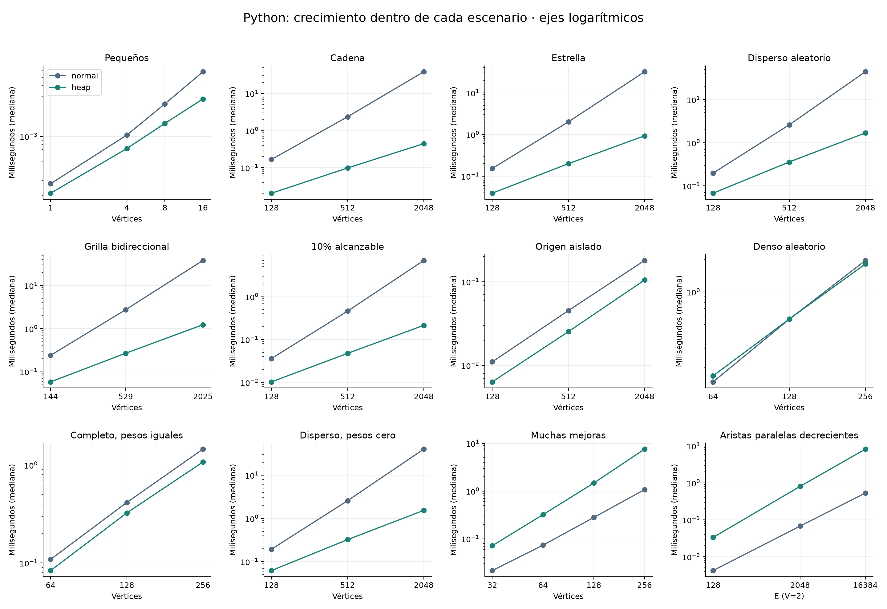
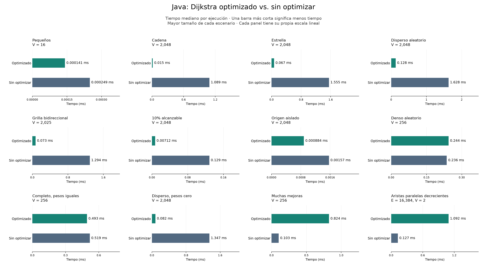
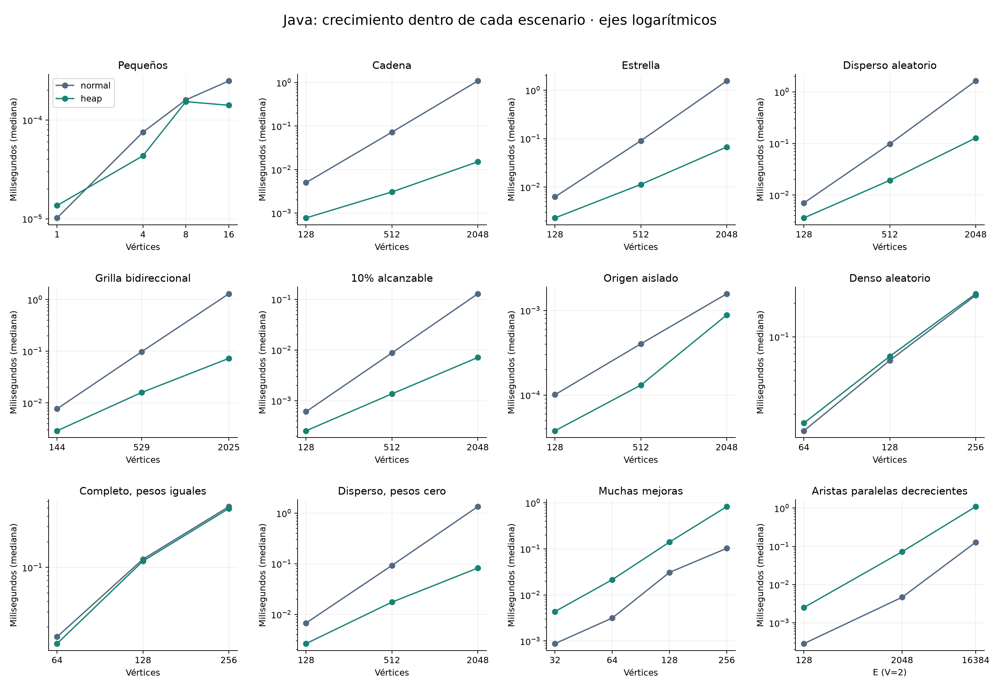
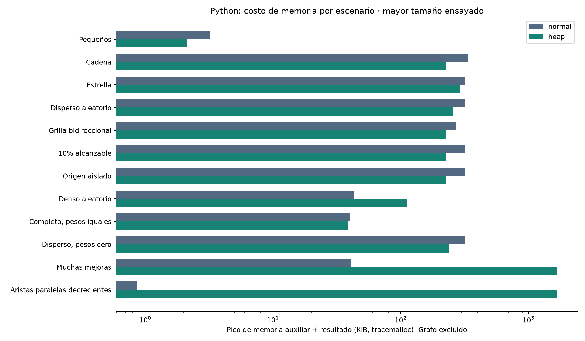

# Dijkstra clásico vs. Dijkstra con heap: resultados del TP1

**La implementación con heap mejora ampliamente al Dijkstra clásico en los
grafos dispersos ensayados, pero no es mejor en todos los escenarios.** La
ventaja disminuye en grafos densos y se revierte cuando hay muchas mejoras de
distancia que acumulan entradas obsoletas. El costo de esas entradas también
puede multiplicar la memoria auxiliar.

Este informe corresponde a la ejecución del **20/10/2026, 21:05, Argentina**
(registro UTC en `results/environment.json`), sobre macOS ARM64, Python 3.14.8
y OpenJDK 21.0.12.1. Es un experimento en un equipo y una ejecución del harness;
los factores medidos no son garantías para otros equipos o distribuciones de
grafos. No se comparan Python y Java entre sí.

## 1. Qué se revisó y qué se agregó

- `main/TP_1/dijkstra_pq.py` ya implementaba Dijkstra con `heapq` y descarte de
  entradas cuya distancia es mayor que la mejor conocida. Es un heap con
  inserciones repetidas, no una implementación con `decrease-key`.
- `main/TP_1_Java/src/algoritmos/Dijkstra.java` implementa la misma estrategia
  con `ColaPrioridadHeap`, un heap binario propio. El grafo tiene listas
  enlazadas y `adyacentes()` construye un array nuevo en cada consulta.
- No existía una versión clásica en ninguna de las dos carpetas. Se agregaron
  `dijkstra_normal.py` y `DijkstraNormal.java`: selección lineal del mínimo y
  la misma representación del grafo y resultado que su respectiva versión heap.
- Se conservaron las dos funciones con heap originales. Se agregaron pruebas,
  generadores reproducibles, contadores separados del reloj, medición y gráficos.

La referencia clásica no es un algoritmo deliberadamente incorrecto o que recorre
aristas inexistentes: usa listas de adyacencia y termina al no quedar vértices
alcanzables. No usa una matriz de adyacencia. Python mantiene un conjunto de
pendientes; Java un array de visitados. Sus costos constantes no son idénticos.

## 2. Evidencia de correctitud

La suite dio **138 pruebas aprobadas y 3 fallos esperados (`xfail` estrictos)**.
Además de los siete tests existentes, cubre casos borde, 100 grafos aleatorios
Python, los contadores y las familias de la matriz. Un test Java compila y ejecuta
un verificador que contrasta **102 grafos en ambas variantes** con Bellman-Ford
calculado en `long`, y comprueba los caminos.

Para grafos pequeños se usa un oráculo independiente, Bellman-Ford, para evitar
que dos variantes con el mismo error parezcan correctas. No se exige que elijan
el mismo camino si hay empates; sí que cada camino sea válido y tenga el costo
mínimo informado. Los grafos de rendimiento se verifican además por igualdad de
distancias entre las dos variantes antes de medirlos.

Las tres limitaciones reproducidas son:

1. **Java: desbordamiento de `int`.** Dos aristas de 2.000.000.000 producen un
   candidato de −294.967.296 en lugar del costo correcto 4.000.000.000.
2. **Java: infinito y distancia válida comparten valor.** Una arista de costo
   `Integer.MAX_VALUE` no se registra como mejora; el camino aparece inaccesible.
3. **Python: etiquetas heterogéneas con empate.** Dos entradas `(1, 1)` y
   `(1, "B")` fuerzan a `heapq` a comparar entero y texto y causan `TypeError`.

Son límites presentes en el código original y permanecen documentados, no
correcciones realizadas. La referencia Java también usa `int` y el mismo
sentinela. Para resultados confiables con costos grandes se recomienda migrar
las distancias/candidatos a `long` y separar claramente el valor infinito. Para
etiquetas generales en Python, agregar un contador de desempate en la cola.
Ninguno de estos cambios fue aplicado a las variantes medidas.

Pesos negativos, NaN/infinito, destinos ausentes y origen inválido quedan fuera
del contrato. Las implementaciones no validan todos estos supuestos. No probar
ciclos negativos ejecutando indefinidamente el algoritmo con heap.

## 3. Diseño del experimento

Se usaron **12 familias, 38 configuraciones de tamaño, 3 semillas y 7 rondas**:
114 instancias por lenguaje y 1.596 muestras de lote por lenguaje, 3.192 en total.
Las familias deterministas repiten el mismo grafo con cada semilla. Cada lote
se calibra buscando al menos 5 ms y se precede de calentamiento; el orden de
algoritmos por ronda y de instancias se aleatoriza con semilla fija.

Se mide la función completa desde un origen a todos los vértices: inicialización,
búsqueda, relajaciones y resultado. Generación, lectura, impresión, contadores,
memoria y gráficos quedan fuera del reloj. Python usa `perf_counter_ns`, sin GC
cíclico durante el tiempo; Java usa `nanoTime`, una JVM con GC habilitado y
`-Xms256m -Xmx1g`. Java es un harness exploratorio, sin JMH ni múltiples forks.

**Ganancia = tiempo normal / tiempo heap.** Un valor mayor que 1 favorece al
heap; uno menor que 1 favorece al clásico. Se informa la mediana de cocientes
pareados por instancia y ronda. P25–P75 describe dispersión; no es un intervalo
de confianza ni una prueba de significancia. El cociente de las medianas de
los tiempos puede diferir de la mediana de cocientes.

La [matriz completa](MATRIZ.md) describe cada construcción, hipótesis, dominio y
métrica. Los datos sin filtrar, versiones y hashes están en [results](results/).
Los gráficos siguientes muestran el mayor tamaño de cada familia; todas las
escalas están en los CSV y las curvas.

## 4. Resultados: Python, clásico contra heap

| Escenario | Tamaño | Normal (ms) | Heap (ms) | Normal / heap | P25–P75 |
|---|---:|---:|---:|---:|---:|
| Pequeños | V=16 | 0.005844 | 0.002784 | 2.095× | 2.071–2.116 |
| Cadena | V=2048 | 38.436209 | 0.445888 | 86.433× | 85.205–87.871 |
| Estrella | V=2048 | 32.127333 | 0.932875 | 34.286× | 33.753–34.751 |
| Disperso aleatorio | V=2048 | 44.597250 | 1.695167 | 25.518× | 24.831–26.598 |
| Grilla bidireccional | V=2025 | 38.201500 | 1.230687 | 31.109× | 30.732–31.745 |
| 10% alcanzable | V=2048 | 6.994292 | 0.214280 | 32.637× | 32.177–33.084 |
| Origen aislado | V=2048 | 0.180115 | 0.105024 | 1.727× | 1.691–1.740 |
| Denso aleatorio | V=256 | 1.957865 | 1.817125 | 1.083× | 1.063–1.091 |
| Completo, pesos iguales | V=256 | 1.456573 | 1.074698 | 1.360× | 1.332–1.375 |
| Disperso, pesos cero | V=2048 | 40.091083 | 1.536594 | 26.152× | 25.810–26.461 |
| Muchas mejoras | V=256 | 1.072172 | 7.589750 | 0.141× | 0.138–0.144 |
| Aristas paralelas decrecientes | E=16384 | 0.530896 | 8.214209 | 0.065× | 0.064–0.066 |

Cada panel muestra dos barras: **Optimizado arriba** y **Sin optimizar abajo**.
La longitud representa milisegundos y una barra más corta es mejor. Cada panel
usa su propia escala lineal para que se puedan leer también los casos pequeños;
comparar las dos barras dentro del mismo panel. Los valores × de la tabla son
una métrica adicional; no son la longitud de estas barras.

En el disperso aleatorio de 2.048 vértices, el tiempo pasa de **44,597 ms a
1,695 ms**, con ganancia pareada de **25,52×**. La cadena alcanza **86,43×** y
la grilla **31,11×**. Son ejemplos claros de ventaja en redes con pocas aristas
por vértice y sin una explosión de mejoras repetidas.

El denso aleatorio de V=64 favorece al clásico (ganancia heap **0,892×**);
V=128 queda cerca del empate (**0,984×**), y V=256 da una ventaja pequeña al
heap (**1,083×**). Por lo tanto, no hay evidencia para decir que el heap domina
los grafos densos. El completo con pesos iguales conserva una ventaja moderada
(**1,36×** en V=256): densidad y cantidad de mejoras son factores distintos.

En el adversario simple dirigido de V=256, el heap tarda **7,590 ms**, frente a
**1,072 ms** del clásico: resulta aproximadamente **7,12× más lento** (inversa
de la mediana de ganancia). En dos vértices con 16.384 aristas paralelas en
orden descendente, resulta **15,33× más lento**. Este último es un multigrafo
deliberadamente adverso, no una carga representativa de todos los grafos.

En la cadena, multiplicar V por 16 (128→2.048) multiplica el tiempo clásico
aproximadamente por 230 y el heap por 22. En el adversario, aumentar V eleva
el número de mejoras y hace crecer la desventaja del heap. Son tendencias
consistentes con el trabajo contado, no una demostración matemática obtenida
ajustando tres puntos. En el origen aislado ambas variantes hacen trabajo
lineal de inicialización; la mejora de 1,73× es de constantes, no de orden.

## 5. Resultados: Java, clásico contra heap

| Escenario | Tamaño | Normal (ms) | Heap (ms) | Normal / heap | P25–P75 |
|---|---:|---:|---:|---:|---:|
| Pequeños | V=16 | 0.000249 | 0.000141 | 1.789× | 1.716–1.851 |
| Cadena | V=2048 | 1.088500 | 0.015086 | 73.621× | 70.015–77.853 |
| Estrella | V=2048 | 1.554750 | 0.067290 | 23.490× | 22.605–24.538 |
| Disperso aleatorio | V=2048 | 1.628448 | 0.127774 | 12.862× | 12.586–14.211 |
| Grilla bidireccional | V=2025 | 1.293708 | 0.072664 | 17.994× | 17.534–20.911 |
| 10% alcanzable | V=2048 | 0.128565 | 0.007121 | 17.832× | 17.287–18.635 |
| Origen aislado | V=2048 | 0.001571 | 0.000884 | 1.712× | 1.584–1.784 |
| Denso aleatorio | V=256 | 0.236108 | 0.244012 | 0.995× | 0.927–1.037 |
| Completo, pesos iguales | V=256 | 0.518594 | 0.493250 | 1.057× | 1.027–1.228 |
| Disperso, pesos cero | V=2048 | 1.347146 | 0.082201 | 16.773× | 15.984–17.725 |
| Muchas mejoras | V=256 | 0.102632 | 0.824448 | 0.121× | 0.088–0.129 |
| Aristas paralelas decrecientes | E=16384 | 0.127346 | 1.091781 | 0.115× | 0.114–0.118 |

Dentro de Java, la cadena, el disperso y la grilla muestran ventajas de **73,62×**,
**12,86×** y **17,99×**, respectivamente. El denso de V=256 está prácticamente
empatado (**0,995×**, con P25–P75 cruzando 1), mientras el adversario de V=256
hace al heap aproximadamente **8,24× más lento**. Las aristas paralelas también
lo perjudican, por aproximadamente **8,67×**.

En V=1 gana el clásico (**0,744×**); los tiempos son del orden de nanosegundos
por llamada y están influidos por asignaciones/JIT. No se debe presentar ese
punto ni las diferencias cercanas a 1× como una regla general. Los saltos de
las curvas pequeñas y densas también requieren cautela: no se controlaron los
forks de JVM ni se midieron pausas de GC.

Estos resultados se leen exclusivamente como normal contra heap dentro de Java.
No se atribuyen diferencias de magnitud entre las dos tablas a los lenguajes.
Ambas variantes Java consultan el mismo ADT y materializan las mismas adyacencias.

## 6. Por qué mejora y por qué se degrada

Contadores Python, mediana por familia en los tamaños indicados arriba:

| Escenario | Selecciones lineales normal | Aristas examinadas, cada variante | Push / pop heap | Extracciones obsoletas | Pico de cola |
|---|---:|---:|---:|---:|---:|
| Cadena | 2,098,176 | 2,047 | 2,048 | 0 | 1 |
| Disperso aleatorio | 2,098,176 | 10,236 | 2,985 | 937 | 1,496 |
| Denso aleatorio | 32,896 | 65,280 | 1,310 | 1,054 | 1,134 |
| Muchas mejoras | 32,896 | 16,383 | 16,384 | 16,128 | 16,256 |
| Aristas paralelas decrecientes | 3 | 16,384 | 16,385 | 16,383 | 16,384 |

En la cadena, ambas variantes recorren **2.047 aristas**. El clásico inspecciona
**2.098.176 candidatos** al mínimo; el heap solo hace **2.048 inserciones y 2.048
extracciones**, con una entrada como máximo. La mejora proviene de eliminar
búsquedas lineales repetidas, no de resolver menos distancias.

El descarte de entradas obsoletas evita volver a recorrer sus adyacencias,
pero **no evita haberlas insertado, almacenado y extraído**. En el adversario
V=256 hay solo 256 vértices, pero **16.128 extracciones obsoletas** y un pico de
**16.256 entradas**. Esa es la causa concreta de la degradación.

Un test adicional invierte el orden de las mismas 512 aristas paralelas:
las distancias se mantienen, pero las entradas obsoletas bajan de 511 a 0 y el
pico de cola de 512 a 1. Esto comprueba que el orden de adyacencia y de las
mejoras puede cambiar mucho el trabajo sin cambiar el problema matemático.
No se cronometró la variante ascendente dentro de la matriz principal.

La complejidad del clásico es **O(V² + E)**, con listas de adyacencia. En la
implementación lazy medida, si R es la cantidad de mejoras exitosas y Eᵣ las
aristas examinadas de vértices alcanzables, el costo es
**O(V + Eᵣ + (R+1) log(R+2))**, y el espacio auxiliar **O(V + R)**, aparte del
grafo. R≤Eᵣ; una cota general es O(V + E log(E+2)). Para grafos simples se suele
expresar como O((V+E) log V). **Con aristas paralelas no debe darse por supuesto
que el heap guarda solo V entradas o que el logaritmo siempre es log V.**
El comentario de complejidad Java original omite esa distinción.

## 7. Memoria: el heap tampoco gana siempre

Pico Python con `tracemalloc`, grafo excluido, resultado incluido. Medianas de
una medición por instancia; no son RSS ni mediciones de Java:

| Escenario | Normal (KiB) | Heap (KiB) | Heap / normal |
|---|---:|---:|---:|
| Cadena | 338.63 | 228.25 | 0.67× |
| Disperso aleatorio | 320.48 | 257.09 | 0.80× |
| Denso aleatorio | 43.02 | 112.49 | 2.61× |
| Muchas mejoras | 40.87 | 1665.99 | 40.77× |
| Aristas paralelas decrecientes | 0.87 | 1661.96 | 1916.50× |

En el adversario, el heap necesita aproximadamente **40,77×** el pico del clásico.
En el caso de aristas paralelas pasa de menos de 1 KiB a unos **1.662 KiB**.
En el disperso y la cadena puede usar menos memoria que esta referencia clásica,
que también mantiene el conjunto de pendientes. No es correcto afirmar que el
heap siempre usa más memoria ni que siempre usa menos: depende de las estructuras
y de cuántas entradas se acumulan.

## 8. Conclusión para presentar

> En los grafos dispersos ensayados, nuestra versión de Dijkstra con heap reduce
> fuertemente el tiempo al reemplazar la selección lineal del mínimo por una cola
> de prioridad. La ventaja crece con el tamaño en cadenas, grillas y redes de grado
> bajo. No es una mejora universal: en grafos densos puede acercarse al empate o
> perder, y ante muchas mejoras sucesivas la estrategia de insertar duplicados
> puede ser varias veces más lenta y consumir mucha más memoria. Medimos ambas
> caras, verificando primero distancias y caminos contra un oráculo independiente.

Para sostener una afirmación breve con evidencia, elegir el disperso de V=2.048
(**25,52×** dentro de Python), explicar las selecciones evitadas y mostrar después
el adversario de V=256 (**7,12× más lento**, **40,77×** de pico auxiliar).
Así la charla presenta una optimización con condiciones de uso claras.

Como siguientes mejoras posibles, evaluar un heap indexado con `decrease-key`
para acotar entradas, depurar aristas paralelas cuando la semántica lo permita,
y corregir los límites numéricos y de etiquetas antes de ampliar el dominio.
Son propuestas futuras, no resultados medidos ni garantías de mejora.

## 9. Alcance y reproducción

Las funciones originales permanecen sin cambios. La [guía de ejecución](README.md)
permite repetir tests y mediciones. `environment.json` guarda los hashes del
código medido; después solo se ajustó el formato de ticks de los gráficos y se
registró ese posprocesamiento por separado, sin modificar tiempos ni algoritmos.
`test_output.txt` conserva el resultado de la suite.

No se controlaron carga externa, frecuencia/temperatura de CPU ni afinidad de
núcleos. No se ejecutaron varias sesiones independientes/JVM forks ni se ajustó
un modelo estadístico. Los pesos y tamaños son sintéticos y finitos; el máximo
disperso es V=2.048 y el máximo denso V=256. Los casos extremos prueban mecanismos,
no su frecuencia en aplicaciones reales. Las diferencias cercanas al empate y
los puntos microscópicos necesitan repetición independiente para una afirmación
más fuerte; las cifras grandes tampoco se deben extrapolar como factores fijos.
